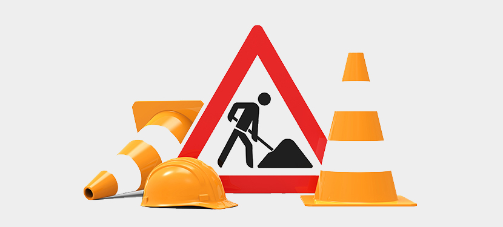
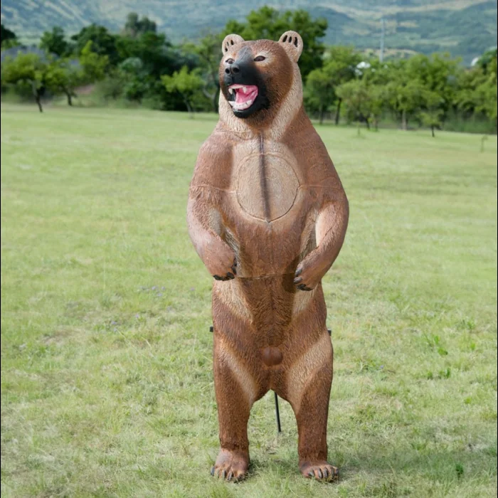
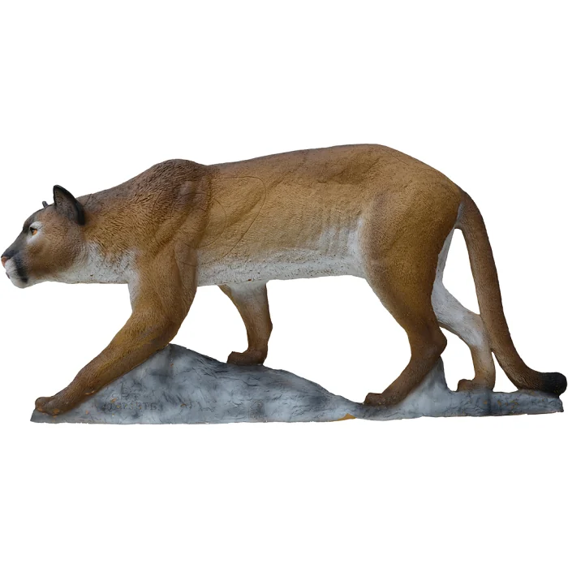
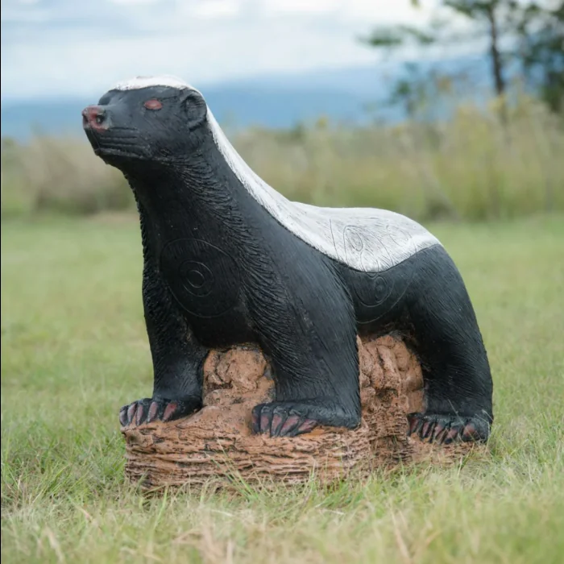
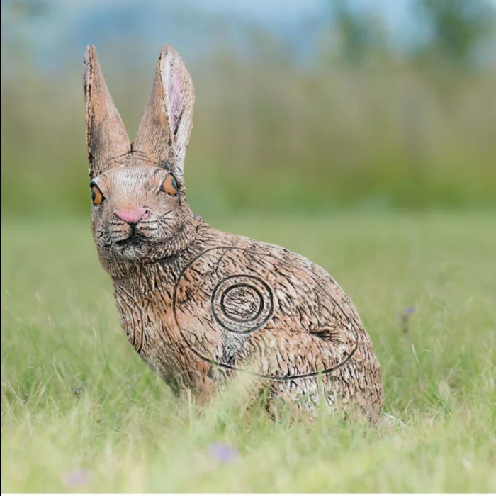
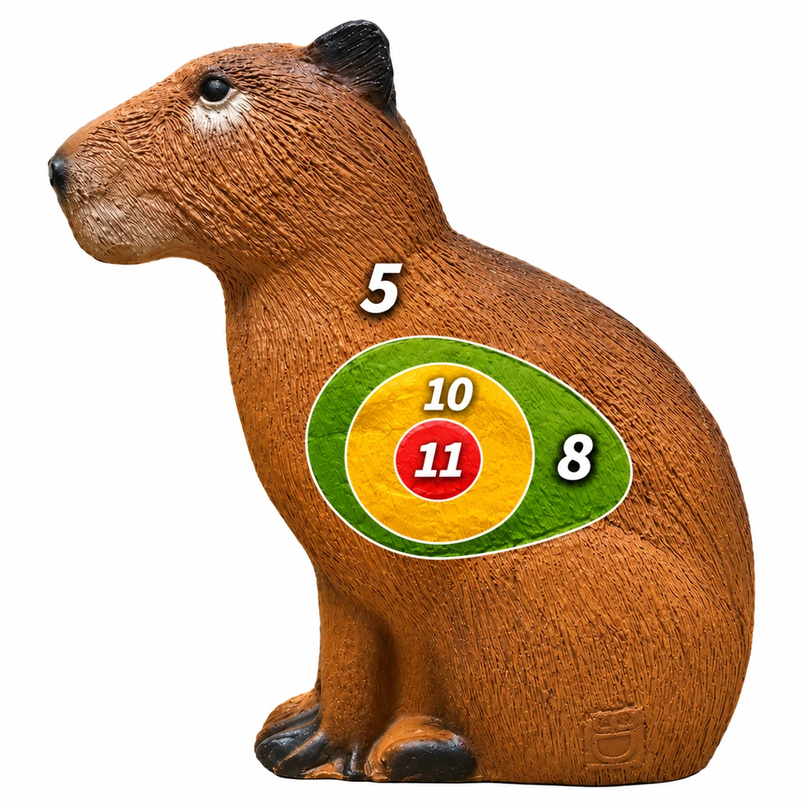

<section class="section">

Discipline FFTA
<h1>Le Tir 3D</h1>
Le Tir 3D est une discipline de tir à l’arc pratiquée sur un parcours en pleine nature. Les archers tirent sur des animaux en mousse en trois dimensions, placés à des distances inconnues qu’il faut estimer. Chaque cible reçoit deux flèches, tirées depuis le même piquet, et les archers passent généralement par deux lorsqu’ils utilisent la même couleur de piquet.
<nav class="page-toc">
Sommaire
<ol><li><a href="#categories-age">Les catégories d’âge</a></li><li><a href="#categories-arcs">Les catégories d’arcs</a></li><li><a href="#cibles">Les cibles 3D</a></li><li><a href="#zones-score">Les zones de score</a></li><li><a href="#points">Les points</a></li><li><a href="#piquets">Les piquets</a></li><li><a href="#distances">Les distances</a></li><li><a href="#deroule">Le déroulé d’une cible</a></li></ol></nav><h2 id="categories-age">Les catégories d'âge</h2>

      En Tir 3D, les archers sont répartis en différentes catégories d’âge. Cette catégorie est déterminée en fonction de l’année de naissance et évolue au fil des saisons. Elle permet notamment d’adapter les conditions de tir, comme le piquet utilisé et les distances.
      Pour la saison 2027, les catégories sont les suivantes :
    

<table>
<thead>
<tr>
<th>Adhérent(e) né(e)</th>
<th>Catégorie d’âge</th>
<th>Âge en 2027</th>
</tr>
</thead>
<tbody>
<tr>
<td>À partir du 01/01/2017</td>
<td>U11</td>
<td>10 ans et moins</td>
</tr>
<tr>
<td>Du 01/01/2015 au 31/12/2016</td>
<td>U13</td>
<td>11 à 12 ans</td>
</tr>
<tr>
<td>Du 01/01/2013 au 31/12/2014</td>
<td>U15</td>
<td>13 à 14 ans</td>
</tr>
<tr>
<td>Du 01/01/2010 au 31/12/2012</td>
<td>U18</td>
<td>15 à 17 ans</td>
</tr>
<tr>
<td>Du 01/01/2007 au 31/12/2009</td>
<td>U21</td>
<td>18 à 20 ans</td>
</tr>
<tr>
<td>Du 01/01/1988 au 31/12/2006</td>
<td>S1 – Senior 1</td>
<td>21 à 39 ans</td>
</tr>
<tr>
<td>Du 01/01/1968 au 31/12/1987</td>
<td>S2 – Senior 2</td>
<td>40 à 59 ans</td>
</tr>
<tr>
<td>Avant le 01/01/1968</td>
<td>S3 – Senior 3</td>
<td>60 ans et plus</td>
</tr>
</tbody>
</table>

<h2 id="categories-arcs">Les catégories d'arcs</h2>

      En Tir 3D, les archers sont répartis en cinq catégories d'arc. Chaque catégorie correspond à un type de matériel et à des règles spécifiques concernant l'équipement utilisé.
    

<h3>Arc nu (Barebow ou BB)</h3>

Le Barebow est un arc dépourvu de viseur et de stabilisateurs, permettant à l'archer de tirer sans dispositif de visée. Seul un repose-flèche et certains accessoires destinés à améliorer le confort et l'équilibre de l'arc sont autorisés, dans des limites précises. La corde ne peut pas comporter de repère destiné à aider à la visée, mais l'archer peut utiliser différentes techniques d'ancrage et de positionnement des doigts. L'ensemble du matériel doit respecter des dimensions et des caractéristiques définies par le règlement fédéral.
     
    Photo : Valérie du club de Miramas

<h3>Arc droit (Longbow ou AD)</h3>

Le Longbow est un arc traditionnel dont la corde, lorsque l'arc est bandé, ne touche que les poupées de l'arc. Il mesure au minimum 150 cm et est utilisé sans viseur, stabilisateur, masse ou amortisseur de vibrations. L'archer tire avec une prise de corde traditionnelle, soit « méditerranéenne », soit avec les trois doigts sous la flèche, et utilise un seul point d'ancrage. Les techniques de repérage sur la corde ou le visage permettant d'aider à la visée ne sont pas autorisées.
     
    Photo : Mélanie du club de Robion
    

<h3>Arc chasse (AC)</h3>

L'arc chasse est un arc classique de type recurve, utilisé nu et sans viseur. Pour la saison 2027, il répond à la définition de l'arc nu, avec un équipement limité et sans dispositif pouvant servir d'aide à la visée. L'archer utilise une prise de corde traditionnelle, soit méditerranéenne, soit avec les doigts sous l'encoche, et conserve un seul point d'ancrage pendant le concours. À partir de la saison 2029, une définition plus précise de l'arc chasse, notamment concernant la composition de la poignée, entrera en vigueur.
     
    Photo : Patrick du club de Rochefort-du-Gard
    

<h3>Arc à poulies nu (CO)</h3>

L'arc à poulies nu est un arc compound dont l'allonge est réglée mécaniquement grâce à un système de poulies ou de cames. Sa puissance est limitée à 60 livres et il est utilisé sans viseur. Certains accessoires sont autorisés, notamment un repose-flèche réglable, un contrôleur d'allonge et un amortisseur ou contrepoids, dans les limites prévues par le règlement. La prise de corde et la technique d'ancrage sont entièrement libres.
     
    Photo : Mélanie du club de Gaujac
    

<h3>Tir libre (TL)</h3>

Le Tir libre utilise un arc à poulies dont l'allonge est réglée mécaniquement par un système de poulies ou de cames, avec une puissance maximale de 60 livres. Contrairement au poulie nu, le viseur est autorisé, tout comme les stabilisateurs et de nombreux accessoires destinés à améliorer la précision et le confort de tir. L'archer peut également utiliser un décocheur. L'équipement reste soumis aux règles de sécurité et aux limitations prévues pour le tir sur parcours.
     
    Photo : Frédéric du club de Gaujac
    

<h2 id="cibles">Les cibles 3D</h2>
En Tir 3D, les archers tirent sur des cibles en mousse représentant des animaux en trois dimensions. Les cibles sont réparties en quatre groupes, selon les dimensions de leurs zones de score. Un parcours de 24 cibles comprend :

<h3>Groupe 1 — Ours</h3>
4 cibles par parcours. Les plus grandes zones vitales.

<h3>Groupe 2 — Puma</h3>
6 cibles par parcours. Grandes zones vitales.

<h3>Groupe 3 — Mouffette</h3>
8 cibles par parcours. Zones vitales intermédiaires.

<h3>Groupe 4 — Lievre</h3>
6 cibles par parcours. Les plus petites zones vitales.

<table><thead><tr><th>Groupe</th><th>Nombre</th><th>Indice de classification</th></tr></thead><tbody><tr><td>Groupe 1 — Très grandes cibles</td><td>4</td><td>9 000 et plus</td></tr><tr><td>Groupe 2 — Grandes cibles</td><td>6</td><td>5 000 à 8 999</td></tr><tr><td>Groupe 3 — Cibles moyennes</td><td>8</td><td>2 000 à 4 999</td></tr><tr><td>Groupe 4 — Petites cibles</td><td>6</td><td>300 à 1 999</td></tr></tbody></table><h2 id="zones-score">Les zones de score</h2>
Les cibles possèdent plusieurs zones de score. Les deux flèches ont la même valeur.

La zone centrale rapporte 11 points, puis 10 et 8 points en s’éloignant du centre. Le reste du corps de l’animal rapporte 5 points, hors parties non comptabilisées.

<table><thead><tr><th>Zone touchée</th><th>Points</th></tr></thead><tbody><tr><td>Petit cercle central</td><td>11</td></tr><tr><td>Cercle intérieur</td><td>10</td></tr><tr><td>Reste de la zone vitale</td><td>8</td></tr><tr><td>Reste du corps de l’animal</td><td>5</td></tr><tr><td>Manqué ou partie non comptabilisée</td><td>0</td></tr></tbody></table><h2 id="points">Les points</h2>
Chaque archer tire deux flèches par cible, depuis le même piquet. Contrairement au Tir Nature, les deux flèches ont la même valeur et leurs points sont additionnés.
<table><thead><tr><th>Élément</th><th>Tir 3D</th></tr></thead><tbody><tr><td>Nombre de cibles</td><td>24</td></tr><tr><td>Flèches par cible</td><td>2</td></tr><tr><td>Total de flèches</td><td>48</td></tr><tr><td>Maximum par cible</td><td>22 points</td></tr><tr><td><strong>Score maximal</strong></td><td><strong>528 points</strong></td></tr></tbody></table><h2 id="piquets">Les piquets</h2>
La couleur du piquet détermine le poste de tir selon la catégorie d’âge et le type d’arc. En Tir 3D, deux archers tirent normalement ensemble depuis un même piquet de couleur.
<ul class="stake-list"><li>
<h4>Piquet jaune — attente</h4>
Point d’attente du peloton avant le tir.

</li><li>
<h4>Piquet rouge</h4>
Tir Libre des catégories U21 à S3.

</li><li>
<h4>Piquet bleu</h4>
Notamment Tir Libre U18 et autres catégories affectées à ce piquet.

</li><li>
<h4>Piquet blanc</h4>
Notamment certaines catégories jeunes et Découverte.

</li><li>
<h4>Piquet rose</h4>
U11 en arc nu (Barebow).

</li></ul><h2 id="distances">Les distances</h2>
Les distances des cibles sont inconnues des archers. Elles varient selon le piquet utilisé et doivent être estimées avant le tir.
<table><thead><tr><th>Piquet</th><th>Distance minimale</th><th>Distance maximale</th></tr></thead><tbody><tr><td>Rouge</td><td>10 m</td><td>45 m</td></tr><tr><td>Bleu</td><td>5 m</td><td>30 m</td></tr><tr><td>Blanc</td><td>5 m</td><td>25 m</td></tr><tr><td>Rose (U11)</td><td>5 m</td><td>20 m</td></tr></tbody></table><h2 id="deroule">Le déroulé d’une cible</h2>
Les archers progressent en peloton. En règle générale, ils tirent par deux depuis le même piquet, sauf exception.
<ol class="timeline"><li>1
<h4>Arrivée au piquet jaune</h4>
Le peloton arrive à la cible et attend au piquet jaune.

</li><li>2
<h4>Placement au piquet de tir</h4>
Les archers se présentent généralement par deux, au même piquet de couleur. Les archers de piquets différents passent séparément.

</li><li>3
<h4>Départ du chronomètre</h4>
Chaque archer dispose de 1 minute 30 secondes pour tirer ses deux flèches.

</li><li>4
<h4>Estimation de la distance</h4>
Les archers évaluent la distance qui les sépare de la cible.

</li><li>5
<h4>Première flèche</h4>
Chaque archer décoche sa première flèche.

</li><li>6
<h4>Seconde flèche</h4>
Chaque archer tire sa deuxième flèche depuis le même piquet.

</li><li>7
<h4>Retour au piquet jaune</h4>
La paire retourne au piquet d’attente et laisse la place aux archers suivants.

</li><li>8
<h4>Déplacement vers la cible</h4>
Une fois tous les tirs terminés, le peloton rejoint la cible.

</li><li>9
<h4>Comptage des points</h4>
Les impacts sont relevés et inscrits avant le retrait des flèches.

</li><li>10
<h4>Cible suivante</h4>
Le peloton poursuit son parcours vers la cible suivante.

</li></ol>

</section>
